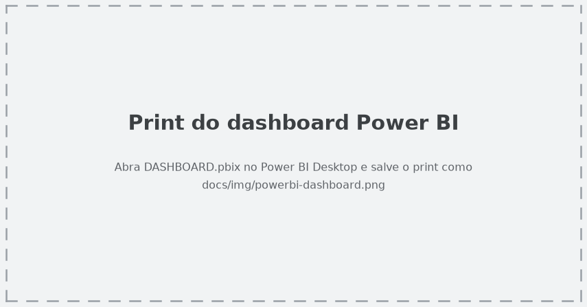
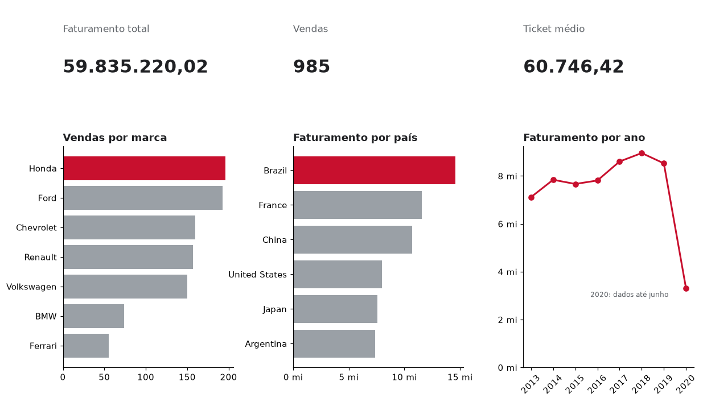
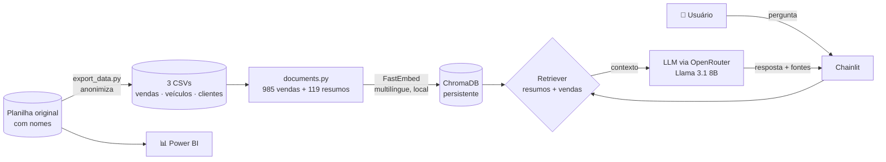

# 🚗 RAG de Vendas de Carros — Chatbot + Dashboard Power BI


Chatbot que responde, em português, perguntas sobre uma base real de **985 vendas de carros** (7 marcas, 54 modelos, 6 países, 2013–2020), usando **RAG (Retrieval-Augmented Generation)**. Junto com ele, um **dashboard em Power BI** apresenta os resultados de vendas.

> Projeto final do curso **"Criando seu primeiro RAG: conectando dados à IA generativa"** — trilha Santander / DIO (RAG com ChromaDB, LlamaIndex e Python).

---

## 📸 Demonstração

### Chatbot (Chainlit)


*Cada resposta mostra as **fontes consultadas** (resumos e IDs de venda), para que o usuário possa conferir de onde veio cada número.*

### Dashboard Power BI



O dashboard foi construído sobre a mesma planilha que alimenta o RAG e contém:

| Visual | O que mostra |
| --- | --- |
| KPI | Soma de vendas do ano vs. **ano anterior** |
| Segmentações | Filtro por **ano** e **mês** (tabela calendário) |
| Barras + cascata | Vendas por **marca** |
| Pizza | Participação de cada **país** nas vendas |
| Treemap | Distribuição por marca |
| Cartões | Marca e modelo em destaque |
| Tooltip personalizado | Lista de modelos ao passar o mouse |

### Visão geral dos dados



*Gerado em Python a partir dos CSVs do projeto (`scripts/gerar_graficos.py`).*

---

## 🎯 O problema e a solução

Um RAG "ingênuo" sobre uma tabela de vendas indexa cada linha e devolve as 5 mais parecidas com a pergunta. Isso funciona para *"me mostre uma venda de BMW I8"*, mas **falha nas perguntas que um gestor de vendas realmente faz** — *"qual marca mais vendeu?"*, *"quanto o Brasil faturou?"* — porque 5 linhas de uma base com 985 não permitem calcular totais. O modelo acaba inventando números ou se recusando a responder.

Este projeto resolve isso com **dois tipos de documento** no mesmo índice vetorial:

| Tipo | Quantidade | Exemplo | Responde |
| --- | --- | --- | --- |
| **Venda** | 985 | `Venda: VEN-000610 / Ford Mustang / 79.980,00 / Brazil` | Perguntas sobre vendas específicas |
| **Resumo** | 119 | `Resumo do país Brazil — 235 vendas, faturamento 14.599.391,58…` | Totais, médias, rankings, comparações |

Os resumos são **calculados de forma determinística em Python** (por marca, modelo, país, região e ano, além de rankings e destaques de preço). O LLM não faz contas: ele só lê números que já estão corretos.

Um **retriever customizado** busca, em consultas separadas com filtro de metadados, os 3 resumos e as 5 vendas mais relevantes. Sem essa separação, as quase mil vendas individuais dominariam a busca e os resumos raramente apareceriam.

## 🏗️ Arquitetura



## 💬 Perguntas que o chatbot responde

| Pergunta | Documento recuperado | Resposta esperada (valores da base) |
| --- | --- | --- |
| Qual marca mais vendeu? | Ranking de marcas | Honda, com 196 vendas |
| Quanto o Brasil faturou no total? | Resumo do país Brazil | 14.599.391,58 em 235 vendas |
| Quantas vendas aconteceram em 2018? | Resumo do ano 2018 | 146 vendas, faturamento de 8.957.729,77 |
| Quais modelos da Ferrari foram vendidos? | Resumo da marca Ferrari | Lista de modelos com quantidade e faturamento |
| Qual foi a venda mais cara? | Resumo de preços | VEN-000610 — Ford Mustang, 79.980,00 (Brasil, 2017) |

Esses casos foram validados na etapa de recuperação: o documento correto aparece entre os 3 primeiros resultados para todas as perguntas acima.

## 🧠 Decisões técnicas

- **Resumos pré-calculados em vez de pedir conta ao LLM.** LLMs pequenos erram aritmética. Calcular em Python garante números exatos e auditáveis.
- **Um nó por registro, sem chunking.** Cada resumo é indexado inteiro, para que o título ("Resumo do país Brazil") nunca se separe dos números a que se refere.
- **Títulos descritivos para o embedding.** O modelo de embeddings considera só o começo do texto (~128 tokens). Por isso, cada resumo começa dizendo que pergunta ele responde, por exemplo *"Responde qual marca mais vendeu…"*. Essa mudança corrigiu casos em que "qual marca mais vendeu?" recuperava o ranking de *modelos*.
- **Reindexação automática.** O índice persistido no ChromaDB guarda um hash dos textos gerados e do modelo de embeddings. Se os CSVs ou o formato dos documentos mudam, o índice é recriado; caso contrário, é reutilizado e o app inicia em segundos.
- **Embeddings locais e multilíngues** (FastEmbed + `paraphrase-multilingual-MiniLM-L12-v2`): sem custo por chamada e com bom desempenho em português.
- **Transparência.** Toda resposta lista as fontes consultadas.
- **Privacidade (LGPD).** A planilha original tem o nome dos clientes. O script de exportação descarta os nomes e gera IDs anônimos (`CLI-0001`…) numerados pela ordem da primeira compra, e não pela ordem alfabética, para não revelar nada sobre o nome. A planilha e o `.pbix` não são versionados.

## 🗂️ Estrutura

```text
data/                     CSVs da base (vendas, veículos, clientes anonimizados)
docs/img/                 imagens do README
scripts/export_data.py    planilha .xlsx -> 3 CSVs anonimizados
scripts/gerar_graficos.py gera docs/img/visao-geral-vendas.png
src/documents.py          monta os textos de vendas e resumos (sem dependência de LLM)
src/main.py               índice ChromaDB, retriever, prompt e app Chainlit
tests/                    testes dos dados e dos resumos
```

## 🚀 Como executar

Pré-requisito: uma chave de API do [OpenRouter](https://openrouter.ai/keys).

### Com Docker

```powershell
Copy-Item .env.example .env   # preencha OPENROUTER_API_KEY
docker compose up --build
```

Abra <http://localhost:8001>. Na primeira execução, o modelo de embeddings é baixado e o índice é criado, o que pode levar alguns minutos. Depois disso, o volume `storage/` preserva o índice.

### Sem Docker (Python 3.12)

O pacote `llama-index-embeddings-fastembed` ainda não suporta Python 3.13 ou mais novo.

```powershell
py -3.12 -m venv .venv
.\.venv\Scripts\Activate.ps1
python -m pip install -r requirements.txt
Copy-Item .env.example .env   # preencha OPENROUTER_API_KEY
chainlit run src/main.py --host 127.0.0.1 --port 8001
```

### Testes

```powershell
python -m unittest discover -s tests -v
```

Os testes verificam a integridade dos CSVs (relacionamentos, ausência de nomes, formatos) e se os resumos batem com os totais da base (contagens, faturamento, rankings e preços).

### Regerar os dados a partir da planilha

```powershell
python scripts/export_data.py "C:\caminho\para\base_dados.xlsx"
```

A planilha precisa de uma aba `base` com as colunas ID, MARCA, MODELO, PREÇO, PAÍS, REGIÃO, NOME e DATA.

## ⚠️ Limitações e próximos passos

- **Filtros combinados muito específicos** (*"vendas de Honda Civic na França em 2016"*) dependem da busca semântica e podem não recuperar todas as vendas. Próximo passo: extrair filtros da pergunta (marca, país, ano) e aplicá-los como filtros de metadados, ou usar busca híbrida (BM25 + vetorial).
- **Perguntas analíticas livres** podem ser atendidas por um agente *text-to-SQL/pandas* combinado ao RAG, para cálculos que não estão nos resumos.
- **Avaliação automática** das respostas (por exemplo, com RAGAS ou o avaliador do LlamaIndex) usando um conjunto fixo de perguntas e respostas esperadas.
- A base não define moeda, então os valores são apresentados sem símbolo monetário.

## 👤 Autor

**Breno Rocha** — [GitHub @brenolrocha22](https://github.com/brenolrocha22)
<!-- Adicione aqui seu LinkedIn: [LinkedIn](https://www.linkedin.com/in/SEU-PERFIL) -->
